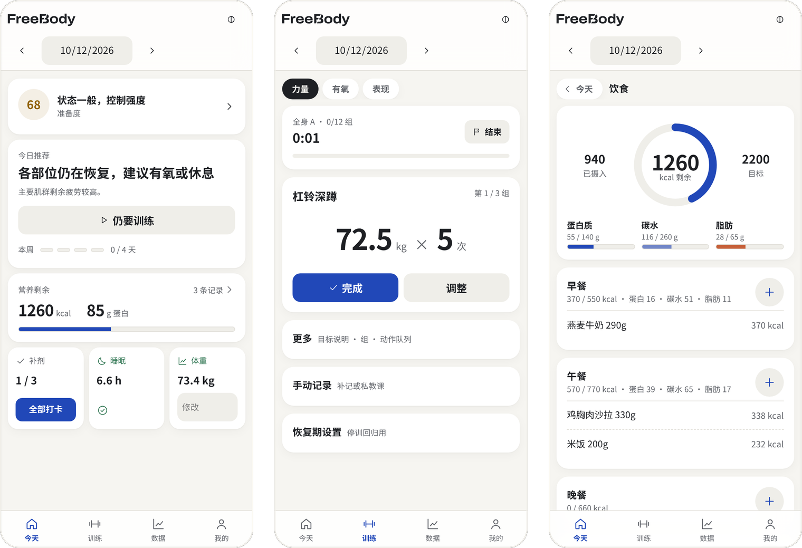
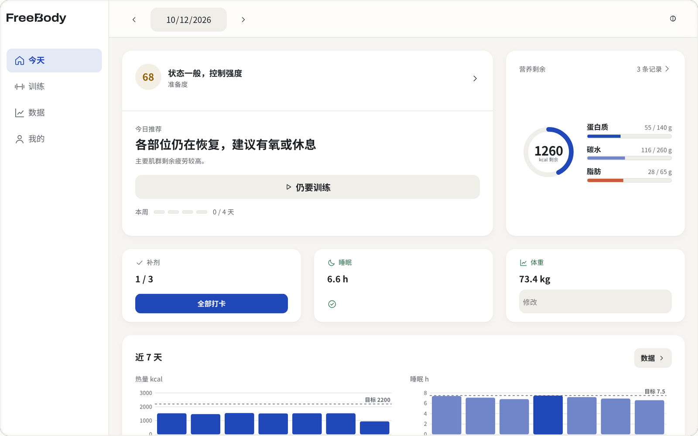
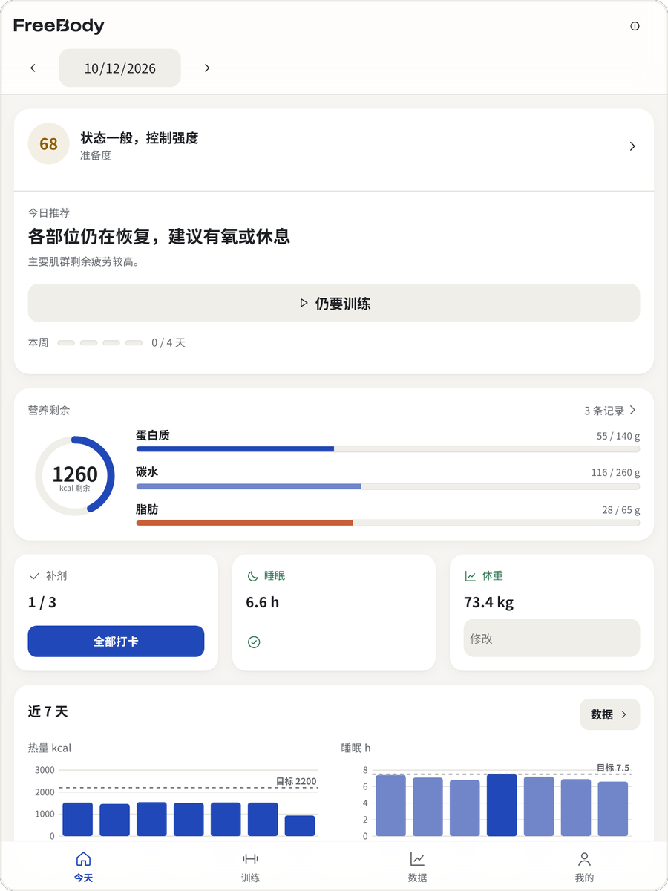
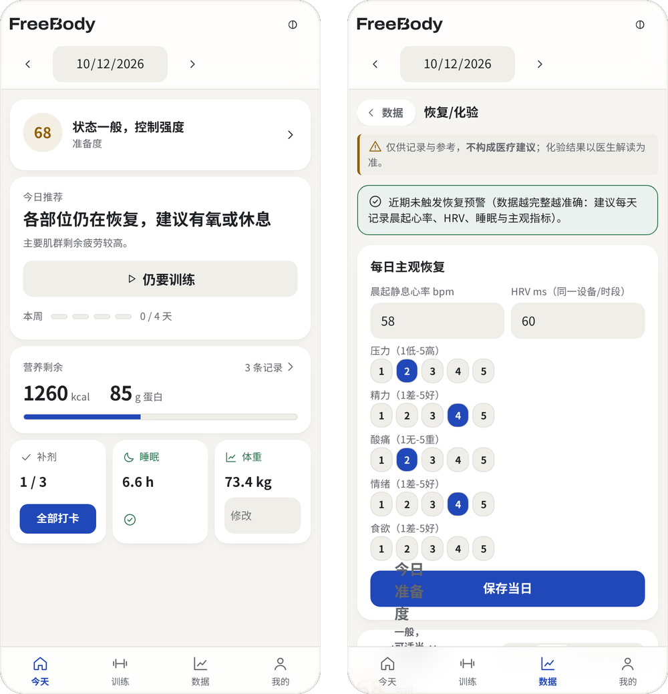
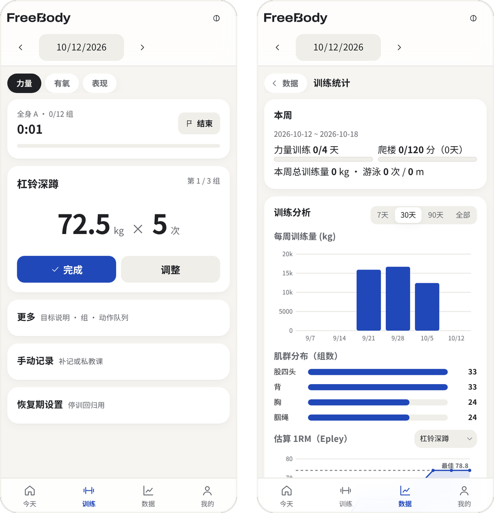
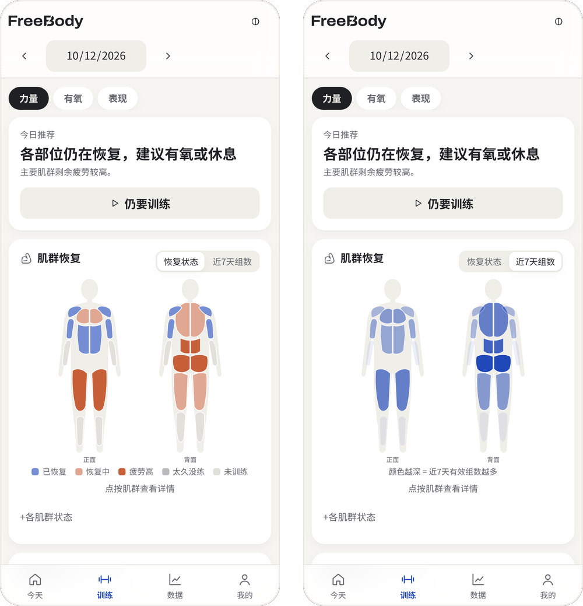
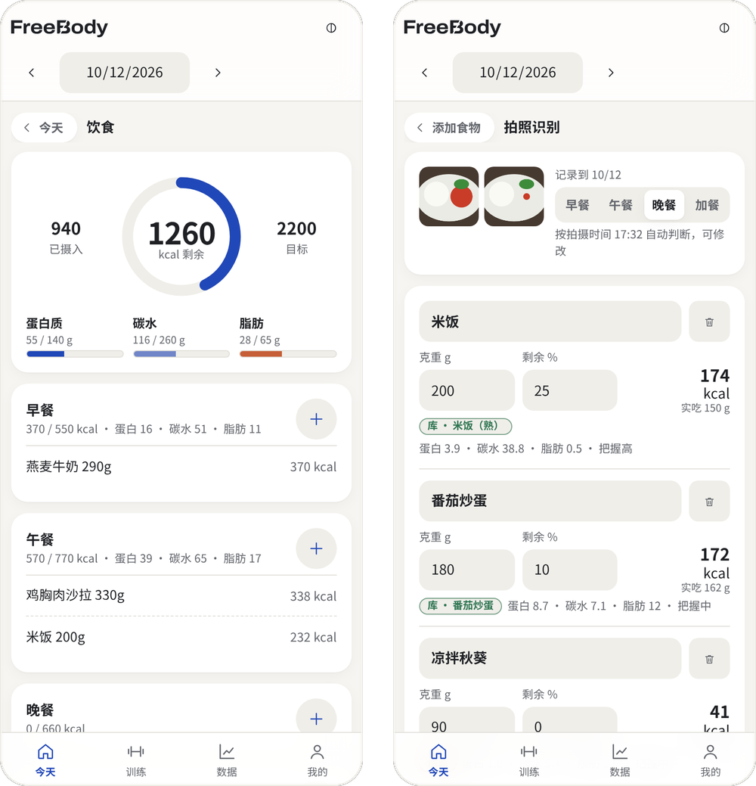
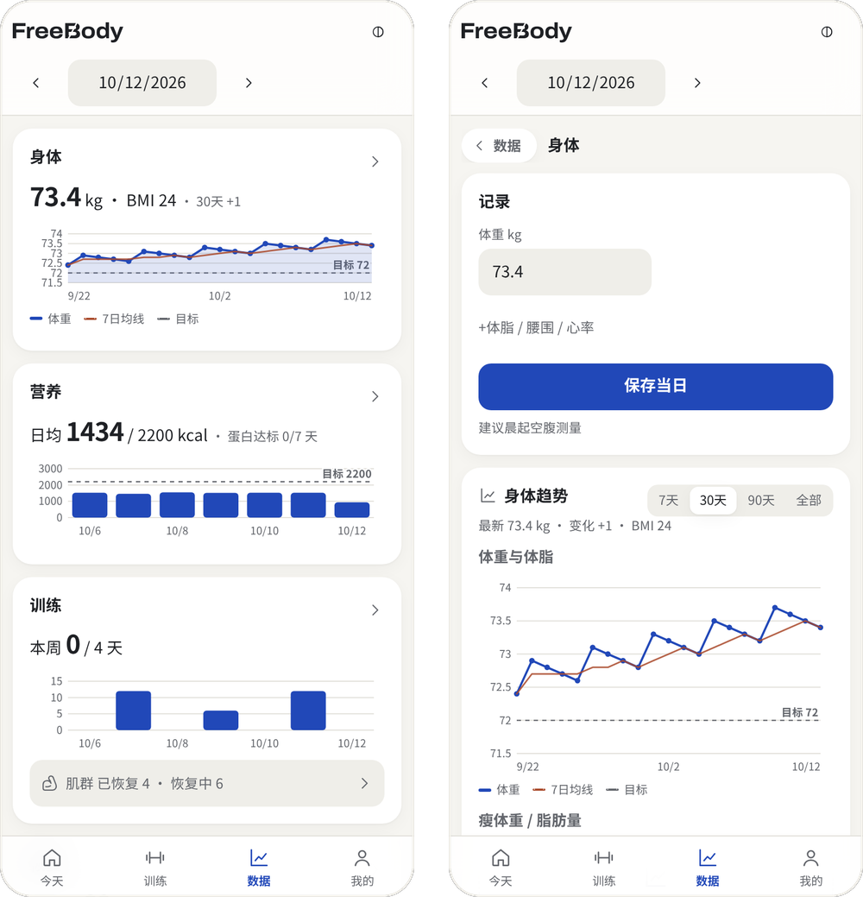
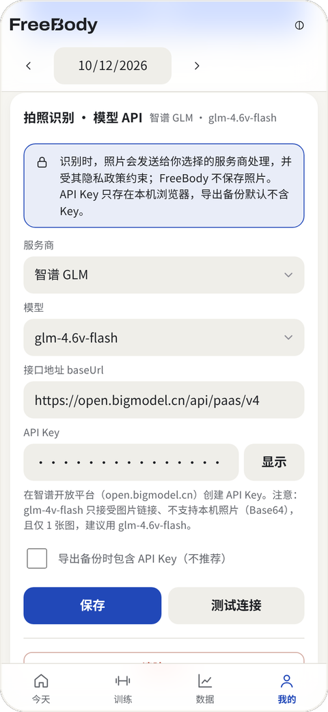
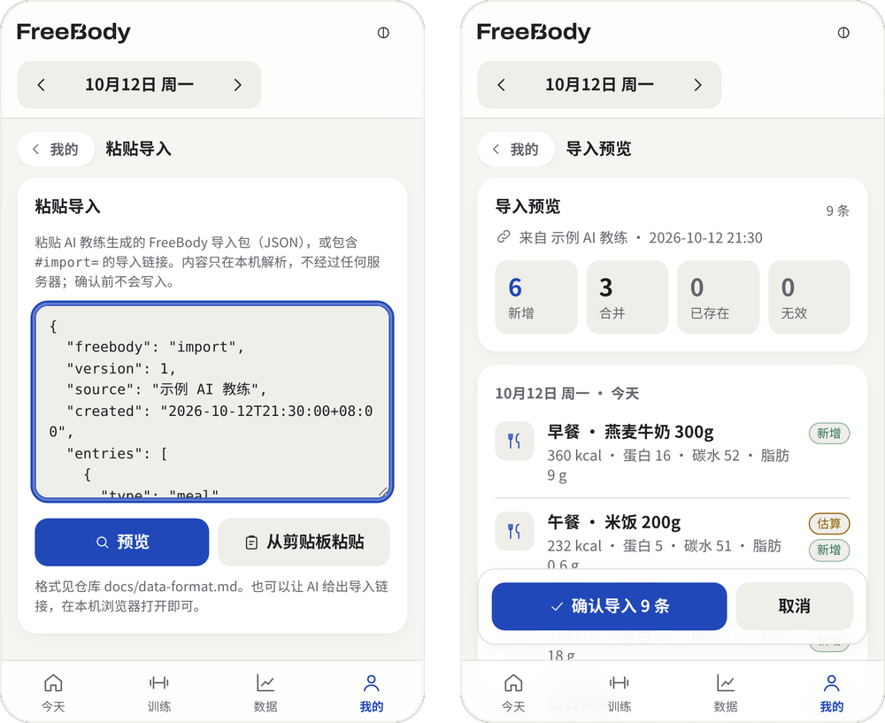

<p align="right"><b>中文</b> | <a href="README.en.md">English</a></p>

<p align="center"><picture><source media="(prefers-color-scheme: dark)" srcset="assets/logo-reverse.svg"></picture></p>

<p align="center">AI 健身教练的仪表盘：你和 AI 聊训练与饮食，FreeBody 负责存储和可视化。数据只在你自己的设备上。</p>

<p align="center">

<a href="LICENSE"></a>

</p>

<p align="center"><a href="https://leenlbma.github.io/freebody/"><b>在线体验 →</b></a> &nbsp;·&nbsp; <a href="#复制给你的-ai">复制给你的 AI</a> &nbsp;·&nbsp; <a href="#快速开始">快速开始</a> &nbsp;·&nbsp; <a href="#搭配-ai-使用">搭配 AI 使用</a> &nbsp;·&nbsp; <a href="README.en.md">English</a></p>

<br>

## 复制给你的 AI

把下面这段提示词复制给你常用的 AI（ChatGPT、Claude、Gemini、Grok、通义等），它就会按 [FreeBody skill](skills/freebody-coach/SKILL.md) 扮演教练：估算饮食、记录训练，并给出可导入的数据或链接。说明见 [搭配 AI 使用](#搭配-ai-使用)。

<!-- freebody-prompt:zh -->
```text
请你担任我的 FreeBody 健身教练：帮我估算饮食、记录训练、给出进阶和恢复建议，并生成可以导入 FreeBody 的数据。
开始前请读取这份 skill，之后严格按照它执行：https://github.com/leenlbma/freebody/blob/main/skills/freebody-coach/SKILL.md
（raw 地址：https://raw.githubusercontent.com/leenlbma/freebody/main/skills/freebody-coach/SKILL.md）
如果你打不开链接，请直接告诉我，我会把 SKILL.md 的全文粘贴给你。
```
<!-- /freebody-prompt -->

应用内的「今天」首次使用卡片和「我的 › 搭配 AI」也能复制同一份提示词，并直接打开 AI 记录预览。剪贴板不可用时可选择文字手动复制。

不能联网的 AI，可以直接复制 [SKILL.md](https://github.com/leenlbma/freebody/blob/main/skills/freebody-coach/SKILL.md) 全文给它。

<sub>同一段提示词也在 [skills/freebody-coach/PROMPT.md](skills/freebody-coach/PROMPT.md)。AI 给出的数据先在本机预览，确认后才写入。不构成医疗建议。</sub>

<p align="center"><picture><source media="(prefers-color-scheme: dark)" srcset="docs/screenshots/hero-phones-dark.png"></picture></p>

<p align="center"><picture><source media="(prefers-color-scheme: dark)" srcset="docs/screenshots/desktop-1280-dark.png"></picture>&nbsp;&nbsp;<picture><source media="(prefers-color-scheme: dark)" srcset="docs/screenshots/tablet-768-dark.png"></picture></p>

<p align="center"><sub>截图为当前版本，使用临时注入的通用示例数据，截图后即丢弃，不含任何个人数据。</sub></p>

<br>

FreeBody 是一个打开就能用的网页应用：一个 `index.html`，无账号、无后台、无第三方依赖。它记录力量训练、有氧、睡眠、体重与饮食，并把这些数据整理成每天可执行的决定：今天练什么、还能吃多少。

你可以在应用里手动记录，也可以把它当作 **AI 健身教练的仪表盘**：在你常用的 AI 里聊训练、发餐食照片，AI 按[公开的数据格式](docs/data-format.md)生成导入包或导入链接，FreeBody 在本机预览、去重合并后写入，再用热图和图表呈现出来。

> 本项目仅用于个人记录与趋势参考，**不构成医疗建议**。化验指标、伤病与补剂相关问题请咨询医生或专业人士。

## 今天页和准备度

一屏回答「今天怎么安排」。准备度综合睡眠、主观恢复、静息心率与 HRV 给出 0–100 分和一句话建议；今日推荐按肌群恢复状态选择推 / 拉 / 腿 / 全身，一键开始。营养剩余、补剂打卡、睡眠确认与体重都在同一屏，打卡只需一次点按。恢复页可展开实际参与评分的项目、归一后的权重与依据；只有少量项目时明确标注「依据有限」。

<p align="center"><picture><source media="(prefers-color-scheme: dark)" srcset="docs/screenshots/f-today-dark.png"></picture></p>

## 按组训练与自动进阶

训练时只显示当前一组的目标重量与次数，两个按钮：完成 / 调整。完成后自动进入组间休息倒计时。下次目标按规则自动计算：做满才加重，连续未完成或停滞提示减载，恢复期与伤处不适时保持。训练统计给出周训练量、肌群组数分布与估算 1RM。

<p align="center"><picture><source media="(prefers-color-scheme: dark)" srcset="docs/screenshots/f-train-dark.png"></picture></p>

## 肌群热图

正反面人体图按恢复状态着色：已恢复、恢复中、疲劳、久未训练、未训练；也可切换为近 7 天组数。点按肌群查看详情，旁边有可读的各肌群状态列表。人体图为本项目自绘的简化 SVG。

<p align="center"><picture><source media="(prefers-color-scheme: dark)" srcset="docs/screenshots/f-muscle-dark.png"></picture></p>

## 饮食与拍照识别

日记页一眼看剩余热量与三大宏量，每餐一个「+」。食物详情分别标注 USDA 条目名称参考、配方估算、同类近似值或用户数值；名称参考可打开 USDA 搜索核对，不代表逐项验证过的精确值。内置 322 项常见中餐与食材，支持最近常吃、自定义食物、组合与一行文字快速记录。

v2.4 起可选拍照识别：拍一张，或吃前、吃后各拍一张，模型按固定格式返回每样食物的名称、克重、剩余比例与估算营养。实际摄入 = 克重 ×（1 − 剩余比例）；营养数值优先匹配本地食物库，匹配不到才使用模型估算并标注「估算」。确认页可逐项改名称、克重、餐次或删除，确认后才记录。

<p align="center"><picture><source media="(prefers-color-scheme: dark)" srcset="docs/screenshots/f-diet-dark.png"></picture></p>

## 本机恢复点

记录或配置保存成功后自动保留「上一次保存前」和每日恢复点，最多 8 份、总量不超过 20 MB。可在「我的 › 数据备份 › 本机恢复点」关闭自动保留、查看、校验导出、确认恢复或清空历史。恢复点不含模型配置和 API Key；演示模式不会读取或改动真实历史。

恢复点与主记录同在这台设备，清除网站数据仍会一起丢失；请继续定期导出外部备份。「清空所有数据」会同时清理主记录、恢复点和旧版存储键。

## 数据可视化

身体、营养、训练、恢复四张卡片，点开看细分：体重与体脂双轴、7 日均线、热量与目标、蛋白达标率、准备度曲线、化验趋势。所有图表为零依赖内联 SVG，可点按查看数值，支持 7 天 / 30 天 / 90 天 / 全部。

**无障碍**：每张图表都带文字摘要（最新值与区间变化），下方可展开「数据表」，读屏软件可以逐行读出；图标按钮都有名称，表单标签与输入框关联；有「跳到主要内容」链接，切换页面会播报；动效跟随系统「减弱动态效果」，也可以在「我的 › 显示与辅助」单独关闭。

<p align="center"><picture><source media="(prefers-color-scheme: dark)" srcset="docs/screenshots/f-data-dark.png"></picture></p>

<br>

## 快速开始

**在线打开**　访问 <https://leenlbma.github.io/freebody/>。首次打开后即可离线使用。

**先看演示**　打开 <https://leenlbma.github.io/freebody/#demo>（或「我的 › 帮助与自检 › 试用演示数据」），载入 4 周虚构记录。演示数据只在当前页面中，不会写入或覆盖你的数据，点「退出演示」即回到自己的数据。

**设备自检**　「我的 › 帮助与自检 › 设备自检」检查本机浏览器的离线、存储、链接导入、安全区等能力，报告不含记录内容，可以复制贴到 issue。真机测试步骤见 [docs/device-test.md](docs/device-test.md)。

**添加到主屏幕**

FreeBody 是 PWA（渐进式网页应用）：通过 https 地址（如上方 Pages 链接或你自己的服务器）打开一次后，即可离线使用，并可像 App 一样安装。主记录保存在本机浏览器的 localStorage，恢复点保存在同源 IndexedDB，安装与否不影响数据。

- **iPhone / iPad（Safari）**：打开网址 → 点底部「分享」按钮 → 选择「添加到主屏幕」→「添加」。之后从主屏幕图标以独立窗口启动、无地址栏。
  - **注意：添加到主屏幕后，数据与 Safari 分开存储。**主屏幕应用打开时是空的，看不到你在 Safari 里记过的数据。如果已经在 Safari 里记录过，请先在 Safari 中打开「我的 › 数据备份」→「导出 JSON」，再到主屏幕应用的同一位置「导入 JSON」。之后固定在一处记录即可。
  - 如果主屏幕应用底部出现空白条、导航没有贴住屏幕底边，请删除主屏幕图标后重新添加（v2.6.0 修复了 iOS 26 上的布局问题，旧图标可能仍沿用旧配置）。
- **Android（Chrome / Edge）**：打开网址 → 右上角菜单 →「安装应用」或「添加到主屏幕」。部分浏览器会在底部自动弹出安装提示。
- **电脑（Chrome / Edge）**：打开网址 → 地址栏右侧的「安装」图标（或菜单 →「投放、保存和分享 → 将页面作为应用安装」）。安装后在独立窗口运行，可固定到任务栏 / 程序坞。

**更新**：发布新版本后，再次打开时页面底部会出现「有新版本，点此刷新」，点一下即切换到新版本；不点则继续使用当前版本。

**本地构建**　需要 Node.js ≥ 18。应用运行时零依赖；构建只用 Node 内置模块，开发检查工具为 devDependencies。

```bash
git clone https://github.com/leenlbma/freebody.git && cd freebody
npm run build    # 生成根目录 index.html 与 sw.js（无需 npm ci）
npm run check    # 语法、emoji、占位符、食物库、导入包 schema 校验
npm test         # 单元测试（node:test）
npm ci && npm run lint && npm run typecheck && npm run test:e2e   # 贡献代码时：lint、类型检查、端到端
```

也可以只下载 `index.html` 直接用浏览器打开（`file://` 下没有离线缓存与更新提示，其余功能照常）。

<details>
<summary>多端布局与快捷键</summary>

- 手机（< 600px）：底部导航，单列卡片。
- 平板竖屏（600–1024px）：8 列网格、间距 16，卡片两栏等高；横屏手机改为左侧图标导航。
- 桌面（> 1024px）与平板横屏：左侧导航栏，12 列网格、内容最大宽 1200、边距与列间距 24；今天页为「主卡 + 营养环 + 打卡 + 近 7 天趋势」。
- 按钮统一为主 / 次 / 危险三种样式、44 / 36px 两档高度；表单底部按钮全宽、成组按钮等宽。
- 支持系统大字体、安全区（刘海 / 底部横条）、键盘焦点样式。
- 快捷键（输入框外）：`1`–`4` 切换 今天 / 训练 / 数据 / 我的，`←` `→` 前一天 / 后一天，`T` 回到今天，`/` 搜索食物，`Esc` 返回上一级；`Enter` / 空格 可激活聚焦的卡片。

</details>

<details>
<summary>部署到自己的 GitHub Pages</summary>

仓库已包含 `.github/workflows/pages.yml`：推送到 `main` 时构建并发布 `index.html`、`sw.js`、`manifest.webmanifest`、`icons/`。fork 后启用方法：

1. 仓库需为公开（私有仓库需付费计划，并设置仓库变量 `ENABLE_PAGES=true`）。
2. Settings → Pages → Build and deployment → Source 选择 **GitHub Actions**（或 `gh api -X POST repos/<owner>/<repo>/pages -f build_type=workflow`）。
3. 在 Actions 里运行一次「Deploy to GitHub Pages」（或推送任意提交），完成后访问 `https://<owner>.github.io/<repo>/`。

**从源码构建**（需 Node.js ≥ 18，构建无第三方依赖）：

```bash
npm run build    # 或 node scripts/build.js  → 生成根目录 index.html
npm run check    # 或 node scripts/check.js  → 语法自检
npm test         # 或 node --test tests/     → 单元测试
```

</details>

## 隐私说明

- **数据只存本地**：主记录保存在本机浏览器的 localStorage（键名 `freeBody_v1`）；自动恢复点保存在同源 IndexedDB（`freebody-history`），不上传任何服务器。旧版 `fitTracker_v1` 数据会自动迁移，旧备份可直接导入。
- **Key 只存本地**：拍照识别的 API Key 单独保存在本机（`freeBody_ai_v1`），导出备份时**默认不包含 Key**（可在设置中勾选包含，不推荐）。也可以取消「在本机记住 API Key」，Key 只留在当前页面内存中，刷新或关闭后需重新填写。
- **导入只在本机处理**：粘贴导入与链接导入（`#import=`）都在浏览器中解析，`#` 之后的内容不会发送给任何服务器，确认前不写入。
- **拍照识别只有在你填写模型 Key 之后才会联网**。没有填写 Key 时，FreeBody 不发起任何网络请求：拍照、选图都只在本机处理，识别入口会引导你手动记录。填写 Key 后，只有你主动点「识别」或「测试连接」时，压缩后的照片（或测试请求）才会直接从浏览器发送到你所选的服务商，不经过 FreeBody 的任何服务器，并受该服务商的隐私政策约束。FreeBody 不保存照片。
- 除此之外，打开网页、离线缓存更新（Service Worker）只会访问 FreeBody 自身所在的网址，不包含你的任何数据。
- **存储安全**：清除浏览器数据或换设备会丢失记录。FreeBody 会在启动时申请持久存储（`navigator.storage.persist()`），本机存储用到约 70% 和 90% 时各提醒一次，写满导致保存失败时立即提示并提供导出；距上次备份满 30 天会提醒（可推迟 7 天）。这些状态都显示在「我的 › 数据备份」。提醒状态与上次备份日期保存在 `freeBody_meta_v1`，不含记录内容。
- 备份含个人健康信息，请妥善保管，不要提交到仓库。需要放进网盘或发给别人时，可在「数据备份 › 加密备份」中填写密码再导出：用 PBKDF2-SHA256（31 万次）派生密钥、AES-GCM 加密，全部在本机完成；密码不保存，忘记后无法恢复。

## AI 识别配置说明

在「我的 › 拍照识别 · 模型 API」中选择服务商、填写 API Key，点「测试连接」确认可用。所有服务商均通过 OpenAI 兼容的 `chat/completions` 接口调用。

<p align="center"><picture><source media="(prefers-color-scheme: dark)" srcset="docs/screenshots/f-aicfg-dark.png"></picture></p>

| 服务商 | 接口地址 baseUrl | 推荐模型 | 获取 Key |
|---|---|---|---|
| 智谱 GLM | `https://open.bigmodel.cn/api/paas/v4` | `glm-4.6v-flash` | 智谱开放平台 open.bigmodel.cn |
| 通义千问 Qwen | `https://dashscope.aliyuncs.com/compatible-mode/v1` | `qwen-vl-plus` / `qwen-vl-max` | 阿里云百炼 bailian.console.aliyun.com |
| Google Gemini | `https://generativelanguage.googleapis.com/v1beta/openai` | `gemini-flash-latest` | Google AI Studio aistudio.google.com |
| 自定义 | 任意 OpenAI 兼容地址 | 支持图片输入的模型 | — |

- `glm-4v-flash` 只接受图片链接、不支持本机照片（Base64），且仅 1 张图，因此默认使用 `glm-4.6v-flash`。
- Gemini 在部分网络环境下无法访问；自定义接口需允许浏览器跨域（CORS）。
- 无网络、跨域失败、Key 无效、限流等情况都会给出明确提示，并可一键改用手动记录。
- 识别结果是估算，确认前请核对克重。

## 搭配 AI 使用

FreeBody 不内置聊天。你继续用自己习惯的 AI，FreeBody 只负责把结果存好、画清楚。

1. **给 AI 装上 skill**：仓库里的 [`skills/freebody-coach`](skills/freebody-coach/SKILL.md) 是一份通用的 Agent Skill（frontmatter 含 `name` 与 `description`），不绑定任何平台。它教 AI 估算饮食（文字、单张照片、吃前吃后对比）、记录训练、按 FreeBody 的进阶与恢复规则给建议，并输出符合 schema 的导入包。支持 skill 的工具可以直接加载这个目录；不支持的，把 `SKILL.md` 的内容作为系统提示或项目说明粘贴进去即可。最省事的做法是复制本页顶部的[提示词](#复制给你的-ai)。
2. **和 AI 聊**：例如「午饭吃了一碗牛肉面，剩了四分之一，帮我记一下」，或「今天深蹲 60kg 5×5，最后两组 RIR 1」。AI 会先列出估算结果请你确认。
3. **导入**：
   - **链接**：AI 给出 `https://leenlbma.github.io/freebody/#import=…`，在你平时使用 FreeBody 的浏览器中打开；
   - **粘贴**：复制 AI 给出的 JSON，在「我的 › 数据备份 › 粘贴导入」中粘贴。
4. **预览确认**：FreeBody 列出每条记录是新增、合并、已存在还是无效，确认后才写入。同一份数据重复导入不会产生重复记录，导入后还可以撤销。

<p align="center"><picture><source media="(prefers-color-scheme: dark)" srcset="docs/screenshots/f-import-dark.png"></picture></p>

- **导入包覆盖**：饮食（餐次、食物、克重、热量、蛋白质 / 碳水 / 脂肪、是否估算）、训练（动作、组、次数、重量、RIR）、补剂、睡眠、体重与身体指标、心得。
- **相关文件**：数据格式见 [docs/data-format.md](docs/data-format.md)，JSON Schema 见 [schema/freebody.schema.json](schema/freebody.schema.json)，示例见 [examples/import/](examples/import/)。
- **生成链接**：`python3 skills/freebody-coach/scripts/make_link.py pack.json`（只用 Python 标准库）。链接较长（约 1800 字符以上）时容易被聊天软件截断，请改用粘贴。
- **安全边界**：skill 规定不做医疗诊断，伤病与异常症状建议就医，导入包中不放个人身份信息。

## 数据来源与免责声明

- 内置食物库 `data/foods.json` 共 322 项。名称、id 与分类为本项目自拟。
- 原料与基础食材的营养数值参考公共事实值，优先参考 [USDA FoodData Central](https://fdc.nal.usda.gov/)（CC0），数值经取整整理。
- 熟菜按本项目自拟配方，由原料生重与熟重比例计算每 100g 数值。
- 每条都有 `ref` 字段注明参考来源或配方。
- 本项目未整表复制《中国食物成分表》或任何第三方数据集。生成方式见 [docs/food-database.md](docs/food-database.md)。
- 食物营养因品种、做法与份量差异很大，库内数值与拍照识别结果都只是估算。准备度、进阶建议与目标推导仅供参考，**不构成医疗、营养或康复建议**。

## 路线图

- 食物库继续补充地方菜与常见外卖，欢迎按 `ref` 规范贡献
- 拍照识别结果与常吃组合的关联，减少重复确认
- 从 FreeBody 导出给 AI 的「近期摘要」，让教练建议基于完整趋势
- 训练计划模板的导入与分享（不含个人数据）

## 贡献

欢迎提交 Issue 与 PR，尤其是食物库条目和[真机测试报告](https://github.com/leenlbma/freebody/issues/new?template=device_report.yml)。新手可以从 [good first issue](https://github.com/leenlbma/freebody/labels/good%20first%20issue) 开始，使用问题请到 [Discussions](https://github.com/leenlbma/freebody/discussions)。参与即表示同意[行为准则](CODE_OF_CONDUCT.md)，安全问题请按 [SECURITY.md](SECURITY.md) 私下报告。食物数据请填写 `source` 与 `ref`，只使用自整理或 CC0 等可再分发的数值，不要提交任何真实个人数据。详见 [CONTRIBUTING.md](CONTRIBUTING.md) 与 [docs/food-database.md](docs/food-database.md)。导入格式或 skill 有改动时，请同步更新 schema、示例和中英文文档，`npm run check` 会校验它们是否一致。

<details>
<summary>项目结构</summary>

```
freebody/
├── index.html                 # 构建产物：可直接打开的单文件应用
├── sw.js                      # 构建产物：Service Worker（版本号随构建内容变化）
├── manifest.webmanifest       # PWA 清单
├── icons/                     # PWA / apple-touch 图标 PNG（scripts/make-icons.py 生成）
├── assets/
│   ├── logo.svg               # 主字标（斜切 B），logo-reverse.svg 为反白版
│   ├── favicon.svg            # 斜切 B 图标（index.html 内已内联同款 favicon）
│   ├── logo-options.png       # 4 个备选方案对比图
│   └── options/               # 备选方案 SVG（存档）
├── src/
│   ├── index.template.html    # 页面结构（含 /*__STYLES__*/ 等占位符）
│   ├── styles.css             # 样式（CSS 变量实现深浅色主题）
│   ├── icons.js               # 内联 SVG 线条图标
│   ├── charts.js              # 零依赖 SVG 图表库
│   ├── app/                   # 应用逻辑模块，构建时按文件名顺序合并进一个 IIFE
│   │   ├── 00-core.js … 08-state.js   # 状态、存储、工具函数、核心计算、导入合并、演示数据、加密备份、恢复点、状态校验（不依赖 DOM，可单测）
│   │   ├── 09-init.js                  # 读取本机数据（损坏时保留原文、暂停保存）
│   │   └── 10-ui-*.js … 90-boot.js     # 各页面界面与启动
│   └── sw.template.js         # Service Worker 模板
├── data/foods.json            # 食物营养库（322 项，每条带 ref 来源）
├── examples/                  # 通用示例配置（profile-sample.json）与导入包示例（import/），不含真实数据
├── schema/                    # 导入包 JSON Schema（freebody.schema.json）
├── skills/freebody-coach/     # 通用 Agent Skill：教 AI 生成导入包与链接（含 PROMPT.md、make_link.py）
├── scripts/build.js           # 内联构建 + 生成 sw.js
├── scripts/check.js           # 语法 / emoji / 食物库 / 导入包 schema 校验
├── tests/                     # node:test 单元测试（核心计算、快速记录、CSV、导入合并、存储与损坏数据）
│   └── e2e/                   # Playwright 端到端测试（Chromium + WebKit：冒烟、axe、导入、演示、损坏数据）
├── types/                     # tsc --checkJs 用的类型声明（数据结构 model.d.ts、全局 globals.d.ts）
├── eslint.config.js · .prettierrc.json · tsconfig.json · playwright.config.js   # 开发工具配置
├── scripts/serve.js           # 本地静态服务器（端到端测试用）
├── scripts/gen-foods.js       # 食物库生成（原料值 + 自拟配方 → foods.json）
├── docs/                      # 架构、测试、数据格式、数据结构、食物库扩展、CSV 导入、真机测试清单、截图
├── .github/                   # CI、Pages 部署、issue / PR 模板（含真机测试报告）
├── CODE_OF_CONDUCT.md · SECURITY.md
├── LICENSE                    # MIT
└── NOTICE                     # 第三方声明
```

代码组织见 [docs/architecture.md](docs/architecture.md)，测试见 [docs/testing.md](docs/testing.md)，数据结构详见 [docs/data-model.md](docs/data-model.md)，更新记录见 [CHANGELOG.md](CHANGELOG.md)。

</details>

## 许可证与致谢

[MIT](LICENSE)。第三方声明见 [NOTICE](NOTICE)。

- 训练引导与肌群恢复可视化的交互思路参考了 openGym（AGPL-3.0），饮食记录流程参考了 OpenNutriTracker（GPL-3.0），均未使用其代码、文案、图片或数据。
- 字标与 B 图标由 Archivo（SIL OFL 1.1）字形轮廓化并定制。
- 食物原料数值参考 USDA FoodData Central（CC0）。
- 拍照识别的提示词与代码为本项目自行编写。
