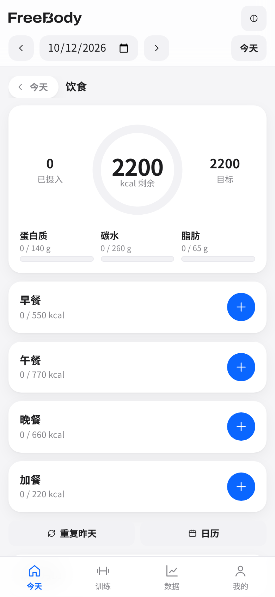
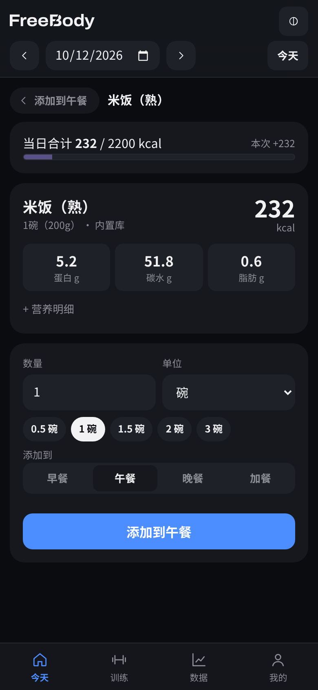
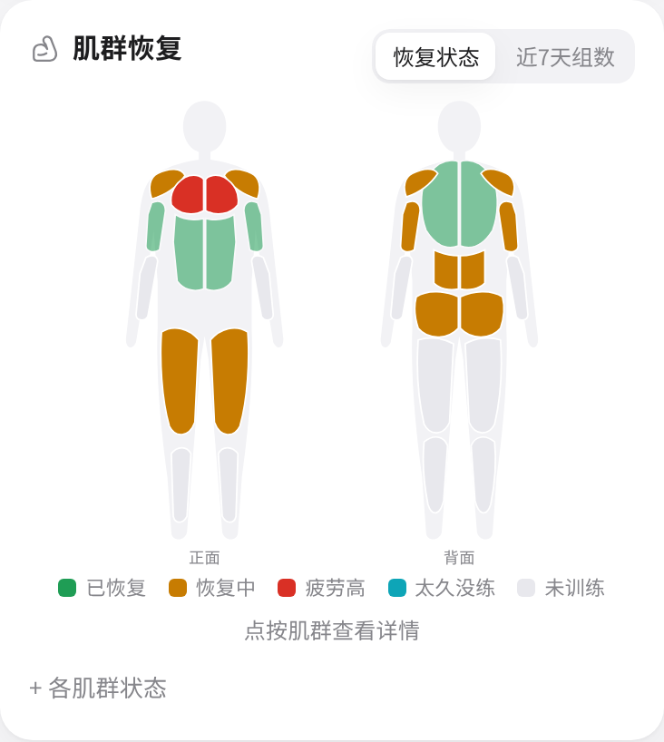
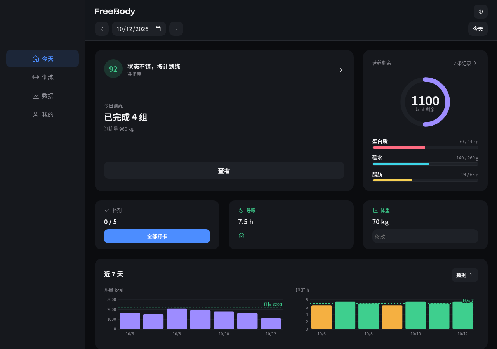
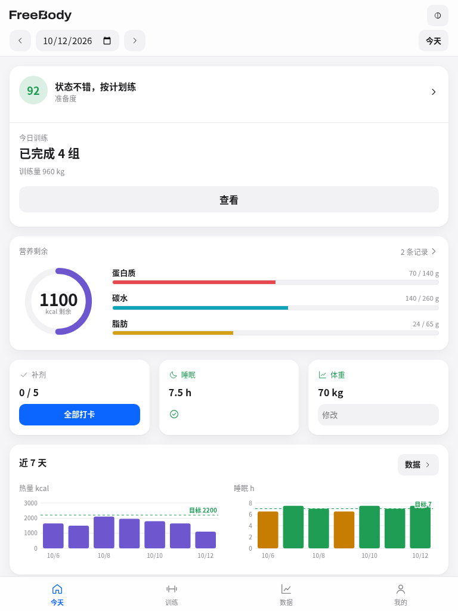

<p align="center"><picture><source media="(prefers-color-scheme: dark)" srcset="assets/logo-reverse.svg"></picture></p>

<p align="center"><b>FreeBody</b> — 身体会变，心永远自由。<br><i>Train the body, keep the heart forever free.</i></p>

一个**单文件、离线可用、零外部依赖**的个人训练与健康记录工具，面向手机浏览器，也适配平板与桌面，可作为 PWA 安装。适合增肌减脂、停训后回归、带伤训练等场景。

> **注意**：本项目仅用于个人记录与趋势参考，**不构成任何医疗、营养或康复建议**。化验指标、伤病与补剂相关问题请咨询医生或专业人士。

## 截图

手机（390 宽）：

   

桌面（1280 宽，深色）与平板（768 宽）：

 

<sub>截图由当前版本生成（v2.3.2）。今天页、饮食日记、食物详情为空模板；肌群热图、桌面与平板截图使用临时注入的通用示例数据，截图后即丢弃，不含任何个人数据。其他截图可放入 `docs/screenshots/`（请勿包含真实个人数据）。</sub>

## 设计原则（v2.0）

- **少即是多**：底部只有 4 个入口 **今天 / 训练 / 数据 / 我的**；高级字段与说明默认折叠（"更多"），所有功能都还在，只是收起来了。
- **一屏今天**：准备度一句话、今日推荐训练（一键开始）、营养剩余、打卡（补剂、睡眠确认、体重、伤处疼痛滑块），无需滚动。
- **一个饮食入口**：日记页一眼看剩余热量与三大宏量；每餐一个「+」，添加、修改、删除都在两步内完成。

### 饮食（v2.2）
流程：**日记 → 餐次「+」→ 添加页 → 食物详情 → 添加**；点按日记条目即可修改份量、移动餐次或删除。

- **日记页**：剩余热量大环（已摄入 / 目标）+ 蛋白质、碳水、脂肪三条进度；早餐 / 午餐 / 晚餐 / 加餐卡片显示「已吃 / 本餐目标」（默认按 25 / 35 / 30 / 10 分配，可改）、宏量小计与已记条目。日期用顶部日期栏切换，或打开「饮食月历」点选某天。
- **添加页**（标题显示添加到哪一餐）：搜索框 + 四个标签 **最近 / 搜索 / 自定义 / 快速加**。每行右侧「+」按默认份量一键加入；点按行进入详情。
  - 最近：近 60 天最常吃 / 最近吃的条目。
  - 搜索：内置库与自定义食物，按名称和别名匹配。
  - 自定义：自建食物（按份）与组合 / 食谱（如「青椒鸡丁+米饭」），可新建和管理。
  - 快速加：一行文字（`鸡胸肉200g 米饭1碗`、`外卖 650`、组合名）；手动 / 照片估算表单（来源选「教练照片估算」，填区间如 750–950，热量默认取中值）。
- **食物详情页**：顶部显示当日合计与「本次 +x kcal」；热量与三大宏量随份量实时变化，营养明细（含膳食纤维、钠与每 100g 数值、来源）折叠；底部为数量 + 单位下拉（g 与该食物的份量单位，如 碗 / 个）、常用份量按钮、「添加到」餐次选择与添加按钮。修改已有条目时按钮变为「保存修改」，并可删除。
- **记录快照**：每条记录保存食物 id、数量、单位、克数与每 100g 营养快照及来源（内置库 / 快速输入 / 教练照片估算 / 自定义），食物库日后更新不影响历史记录。照片估算条目标注「估算 750–950」，点按可改。
- **饮食月历**（折叠）：按热量达标着色，显示连续记录天数，并按近 6 周体重趋势估算达到目标体重的大致日期。
- **目标怎么来的**（折叠）：BMR（Mifflin-St Jeor；有体脂时可选 Katch-McArdle）× 活动系数 → 缺口 / 盈余 → 手动偏移，蛋白按 g/kg 体重，附文献；可一键应用到饮食目标。缺少身高、体重、年龄或性别时只提示，不自动填写。

## 功能

### 今天
| 卡片 | 内容 |
|---|---|
| 准备度 | 0–100 分 + 一句话建议；恢复不足信号≥2 项时提示减量；点按进入 恢复/化验 |
| 今日推荐 | 按肌群恢复状态推荐 推 / 拉 / 腿 / 全身；"开始训练"直接进入引导；训练中显示"继续训练" |
| 营养剩余 | 剩余热量与蛋白；点按进入饮食 |
| 打卡 | 补剂全部打卡、睡眠确认（沿用上次）、体重、伤处疼痛 0–10 滑块（有未恢复伤病时显示） |

### 训练
- **开始今日推荐**：优先使用与推荐部位匹配的已有计划，否则用通用模板。
- **肌群恢复热图**（今日推荐下方）：正反面人体，恢复状态 / 近 7 天组数切换，点按肌群显示详情；各肌群状态列表默认折叠。训练进行中自动隐藏。
- **逐组引导**：只显示当前一组的大号目标（重量 × 次数）与两个按钮：**完成** / **调整**（调整时显示重量、次数步进器与 RIR）。完成后自动进入组间休息倒计时（+30 秒 / 跳过）。
- **更多**（折叠）：进阶规则与目标说明、本动作各组（点按撤销）、RIR 说明、加一组、下一个动作、伤处不适标记、动作队列、追加动作、放弃训练。
- **其他计划**（折叠）：自建计划（每个动作可选 线性 / 双重进阶 / 保持）、通用模板、自由训练。
- **完成总结**：时长、组数、训练量、估算 1RM 新纪录、每个动作的下次目标与理由。
- **自动进阶**：未做满不加重；连续 2 次未完成或连续 3 次无进步提示减载 10%；恢复期前 2 周或伤处不适时保持；RIR 与 RPE 互通（RPE = 10 − RIR）。
- 手动记录（补记、私教课）、恢复期设置均折叠在页面下方；子标签 **力量 / 有氧 / 表现**（爬楼、游泳、100m 蛙泳 PB、800m、自定义测试）。

### 数据
4 张核心卡片，点开看细分：

| 卡片 | 概览 | 点开 |
|---|---|---|
| 身体 | 最新体重、30 天变化、30 天趋势 | 体重 + 体脂双轴、瘦体重/脂肪量、腰围、历史 |
| 营养 | 近 7 天日均热量、蛋白达标天数、7 天热量柱 | 热量与目标、宏量比例、蛋白达标率、宏量构成 |
| 训练 | 本周训练天数与训练量、肌群恢复摘要 | 训练统计（周训练量、肌群分布、估算 1RM、频率热力）；肌群热图见「训练」页 |
| 恢复 | 准备度、睡眠 7 天均值、14 天准备度曲线 | 主观恢复、静息心率/HRV、化验趋势 |

"更多"中可进入 睡眠、伤病与限制、补剂、运动表现 等全部板块。所有图表为零依赖内联 SVG，深浅色自适应，可点按查看数值，支持 7天 / 30天 / 90天 / 全部。

### 我的
常用入口、个人配置、示例配置、食物库、其他目标、批量导入 CSV（见 [docs/csv-import.md](docs/csv-import.md)）、数据备份。

界面不使用 emoji，统一为内联 SVG 线条图标（`src/icons.js`）。

## 使用方式

**在线使用**：<https://leenlbma.github.io/freebody/>（GitHub Pages，首次打开后可离线使用，可安装到桌面 / 主屏幕，见下文）。

**直接使用**：下载 `index.html`，用手机或电脑浏览器打开即可。无需联网、无需安装。以 `file://` 本地打开时 Service Worker 不可用，应用照常运行（只是不会出现"安装"与更新提示）。

### 安装到手机 / 电脑

FreeBody 是 PWA（渐进式网页应用）：通过 https 地址（如上方 Pages 链接或你自己的服务器）打开一次后，即可离线使用，并可像 App 一样安装。数据仍只保存在本机浏览器的 localStorage 中，安装与否不影响数据。

- **iPhone / iPad（Safari）**：打开网址 → 点底部「分享」按钮 → 选择「添加到主屏幕」→「添加」。之后从主屏幕图标启动为全屏、无地址栏。注意 iOS 上主屏幕应用与 Safari 的存储彼此独立，迁移数据请先在「我的 → 数据」导出 JSON 再导入。
- **Android（Chrome / Edge）**：打开网址 → 右上角菜单 →「安装应用」或「添加到主屏幕」。部分浏览器会在底部自动弹出安装提示。
- **电脑（Chrome / Edge）**：打开网址 → 地址栏右侧的「安装」图标（或菜单 →「投放、保存和分享 → 将页面作为应用安装」）。安装后在独立窗口运行，可固定到任务栏 / 程序坞。

**更新**：发布新版本后，再次打开时页面底部会出现「有新版本，点此刷新」，点一下即切换到新版本；不点则继续使用当前版本。

### 多端布局与快捷键

- 手机（< 600px）：底部导航，单列卡片。
- 平板竖屏（600–1024px）：8 列网格、间距 16，卡片两栏等高；横屏手机改为左侧图标导航。
- 桌面（> 1024px）与平板横屏：左侧导航栏，12 列网格、内容最大宽 1200、边距与列间距 24；今天页为「主卡 + 营养环 + 打卡 + 近 7 天趋势」。
- 按钮统一为主 / 次 / 危险三种样式、44 / 36px 两档高度；表单底部按钮全宽、成组按钮等宽。
- 支持系统大字体、安全区（刘海 / 底部横条）、键盘焦点样式。
- 快捷键（输入框外）：`1`–`4` 切换 今天 / 训练 / 数据 / 我的，`←` `→` 前一天 / 后一天，`T` 回到今天，`/` 搜索食物，`Esc` 返回上一级；`Enter` / 空格 可激活聚焦的卡片。

### 部署到 GitHub Pages

仓库已包含 `.github/workflows/pages.yml`：推送到 `main` 时构建并发布 `index.html`、`sw.js`、`manifest.webmanifest`、`icons/`。fork 后启用方法：

1. 仓库需为公开（私有仓库需付费计划，并设置仓库变量 `ENABLE_PAGES=true`）。
2. Settings → Pages → Build and deployment → Source 选择 **GitHub Actions**（或 `gh api -X POST repos/<owner>/<repo>/pages -f build_type=workflow`）。
3. 在 Actions 里运行一次「Deploy to GitHub Pages」（或推送任意提交），完成后访问 `https://<owner>.github.io/<repo>/`。

**从源码构建**（需 Node.js ≥ 14，无第三方依赖）：

```bash
npm run build    # 或 node scripts/build.js  → 生成根目录 index.html
npm run check    # 或 node scripts/check.js  → 语法自检
```

## 项目结构

```
freebody/
├── index.html                 # 构建产物：可直接打开的单文件应用
├── sw.js                      # 构建产物：Service Worker（版本号随构建内容变化）
├── manifest.webmanifest       # PWA 清单
├── icons/                     # PWA / apple-touch 图标 PNG（scripts/make-icons.py 生成）
├── assets/
│   ├── logo.svg               # 主字标（斜切 B），logo-reverse.svg 为反白版
│   ├── favicon.svg            # 斜切 B 图标（index.html 内已内联同款 favicon）
│   ├── logo-options.png       # 4 个备选方案对比图
│   └── options/               # 备选方案 SVG（存档）
├── src/
│   ├── index.template.html    # 页面结构（含 /*__STYLES__*/ 等占位符）
│   ├── styles.css             # 样式（CSS 变量实现深浅色主题）
│   ├── icons.js               # 内联 SVG 线条图标
│   ├── charts.js              # 零依赖 SVG 图表库
│   ├── app.js                 # 应用逻辑（按板块分节注释）
│   └── sw.template.js         # Service Worker 模板
├── data/foods.json            # 食物营养库（欢迎贡献）
├── examples/                  # 可选通用示例配置（profile-sample.json，不含任何记录数据）
├── scripts/build.js           # 内联构建 + 生成 sw.js
├── scripts/check.js           # 语法自检
├── docs/                      # 数据结构、食物库扩展、CSV 导入、截图
├── LICENSE                    # MIT
└── NOTICE                     # 第三方声明
```

## 数据与隐私

- 所有数据**只保存在你本机浏览器的 localStorage**（键名 `freeBody_v1`），不上传任何服务器，应用不发起任何网络请求。
- **从旧版升级**：首次打开 v2.0 时，若本机存在旧键 `fitTracker_v1` 的数据，会自动复制到 `freeBody_v1`（旧键保留不删）。数据结构与 v1.x 完全兼容，旧版导出的 JSON 也可直接导入。
- **导出**：我的 › 数据备份 › 导出 JSON。**导入**：选择备份 JSON，确认后覆盖当前数据。
- 清除浏览器数据/换设备会丢失记录，请定期导出备份。导出文件含个人健康信息，请妥善保管，**不要提交到仓库**（`.gitignore` 已忽略 `freebody-*.json` 与旧版 `fitness-tracker-*.json`）。
- 默认模板通用，不含任何个人数据；`examples/` 中仅有通用示例（内容均标注「示例」），需手动加载，且仅合并配置与清单。
- 个人配置请保存在仓库外，通过「我的 › 示例配置 › 从文件加载配置」加载，不要提交到仓库。

数据结构详见 [docs/data-model.md](docs/data-model.md)。

## 贡献

欢迎提交 Issue / PR，尤其是食物库条目。见 [CONTRIBUTING.md](CONTRIBUTING.md) 与 [docs/food-database.md](docs/food-database.md)。

## 许可证

[MIT](LICENSE)。第三方声明与设计参考说明见 [NOTICE](NOTICE)：训练引导等交互思路参考了 openGym（AGPL-3.0），但未使用其任何代码、文案或素材；人体肌群图为本项目自绘的简化 SVG；字标与 B 图标由 Archivo（SIL OFL 1.1）字形轮廓化并定制。
